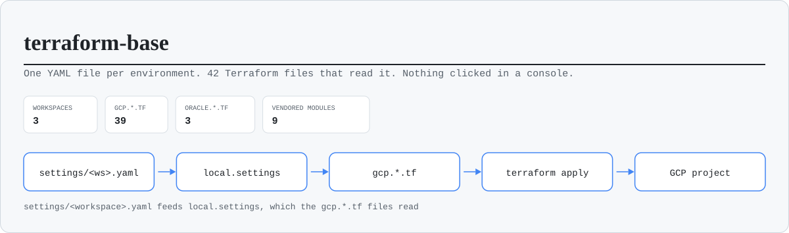
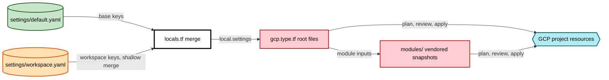
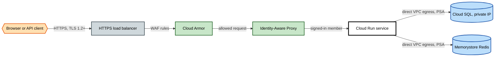

<h1 align="center">terraform-base</h1>

<p align="center">
  <em>A Terraform template for Google Cloud: one YAML file per environment, cheap dev
  and stg, and a pro workspace hardened for a security, backup and retention audit.</em>
</p>

<p align="center">
  <a href="LICENSE"></a>
  <a href="versions.tf">= 1.14.0" src="https://img.shields.io/badge/terraform-%3E%3D%201.14.0-7b42bc"></a>
  <a href="versions.tf"> 7.42.0" src="https://img.shields.io/badge/google%20provider-~%3E%207.42.0-4285f4"></a>
  <a href="https://github.com/0xBroom/terraform-base/actions/workflows/terraform.yml"></a>
  
</p>

<p align="center">
  
</p>

## Why

- **Configuration, not code.** A Cloud Run service, a bucket, a database or an alert is
  a block of YAML. New Terraform is only needed for a resource type the template does
  not cover yet.
- **Cost follows the environment.** Dev scales to zero with no load balancer, stg has
  the shape of pro at a fraction of the price, and pro is regional and warm.
- **Pro is ready for an audit.** Locked audit logs, backups with point-in-time
  recovery, IAP, Cloud Armor, signed images and security alerts that name who made
  a change, each one mapped to ISO 27001, SOC 2 and GDPR in
  [docs/COMPLIANCE.md](docs/COMPLIANCE.md).

## What you get

A section missing from the YAML creates nothing.

| Area | Capabilities | YAML keys |
|---|---|---|
| Compute | Cloud Run services and jobs, Cloud Scheduler, Cloud Tasks, Pub/Sub, Compute Engine VMs, optional Oracle Cloud VMs | `app.service`, `app.job`, `scheduler`, `service_scheduler`, `cloud_tasks`, `pubsub`, `compute_instances`, `oracle` |
| Data | Cloud SQL with backups and point-in-time recovery, Memorystore Redis, Firestore, Cloud Storage buckets, Secret Manager, SOPS-encrypted secret values | `database`, `redis`, `firestore`, `bucket`, `secrets`, `external_secret_access`, `sops` |
| Network | One shared VPC with Private Service Access and Cloud NAT, its firewall rules, the HTTPS load balancer with managed certificates, Cloud DNS, Private Service Connect to Elastic Cloud | `network`, `compute_nats`, `lb`, `dns_zones`, `domain_mappings`, `elastic_psc` |
| Security | IAP, Cloud Armor, viewer and operator access lists, audit log config, service account key policy, Essential Contacts, Binary Authorization, workload identity federation | `iap`, `lb`, `project_access`, `security`, `binary_authorization`, `wif` |
| Delivery | One Cloud Build trigger per service with optional scans, standalone triggers, Artifact Registry with cleanup policies, GitHub and Bitbucket connections | `app.service.<name>.cloudbuild`, `cloudbuild`, `artifact_repos`, `artifact_cleanup`, `repo_providers` |
| Observability | Log retention, a locked audit log archive, log-based security alerts, load balancer alerts, uptime checks, secret read alerts, a billing budget | `logging`, `monitoring`, `budget` |

Firewall rules exist only when the workspace has a `network` section.

## How it works

`locals.tf` loads `settings/default.yaml`, merges `settings/<workspace>.yaml` over it
and exposes the result as `local.settings`. Each `gcp.<type>.tf` file reads its own
section and either declares the resources or calls a vendored module under
`modules/`. One Terraform workspace is one environment, one GCP project and one YAML
file; all workspaces share one state bucket.



A request to the app in stg and pro takes this path. Dev skips the load balancer and
serves its run.app URL to callers with `roles/run.invoker`.



## Quick start

1. **Prerequisites.** Terraform 1.14.0 or later, the `gcloud` CLI with application
   default credentials (`gcloud auth application-default login`), one GCP project per
   environment and an ops project that holds the state bucket. `AGENTS.md` describes
   the folder and project layout and the commands to create it.
2. **Settings.** In `settings/default.yaml` set `client.name` (the prefix of every
   resource name), `region_name` and `iac.repo`. In `settings/dev.yaml`, `stg.yaml` or
   `pro.yaml` replace the placeholders: `example-app-<env>`, the billing account
   `000000-000000-000000`, `replace-me@example.com` and the GitHub owner
   `example-org`. Another environment starts as a copy of the closest file.
3. **Backend.** `cp backend.hcl.example backend.hcl` and set `bucket` to the state
   bucket (and `prefix` if several stacks share it). `backend.hcl` is gitignored.
4. **Init.**
   ```bash
   terraform init -backend-config=backend.hcl
   ```
5. **Workspace.** The name picks the settings file.
   ```bash
   terraform workspace new dev
   ```
6. **Plan.**
   ```bash
   terraform plan -out=dev.tfplan
   ```

Read the whole plan before any apply, and stop at every destroy or replace of
something that holds data. Then `terraform apply dev.tfplan` applies exactly what you
read. `terraform output` prints what comes next (see [Outputs](#outputs)).

## Environments

The three reference workspaces describe one service with a database, a bucket and a
budget. `settings/pre.yaml` is the stg profile under its older name. Full matrix and
reasons: [docs/ENVIRONMENTS.md](docs/ENVIRONMENTS.md).

| | `dev` | `stg` | `pro` |
|---|---|---|---|
| Profile | smallest that runs: Cloud Run scales to zero, `db-f1-micro`, no Redis, no NAT | shape of pro, one size down: `db-custom-1-3840`, Redis basic, Cloud NAT | one warm 2 vCPU instance, `db-custom-2-7680`, Redis standard HA, Cloud NAT |
| Availability | zonal | zonal | regional Cloud SQL, Redis with a replica |
| Protection | none, disposable | Cloud SQL deletion protection | deletion protection on Cloud Run, Cloud SQL and Redis; locked audit archive |
| Backups and PITR | 7 backups, no PITR | 7 backups, no PITR | 30 backups, 7 days of PITR, Redis snapshot every 12 hours |
| Entry point | run.app URL, IAM only | load balancer, Cloud Armor, IAP | load balancer, Cloud Armor, IAP, `RESTRICTED` TLS |
| Monthly cost, estimate | about 10 to 25 USD | about 130 to 160 USD | about 420 to 500 USD |
| Budget (`budget.amount`, EUR) | 25 | 80 | 400 |

The estimates are list prices in `europe-west1` for an idle project with little
traffic, not a quote.

## Cost

- **What drives it.** The load balancer forwarding rule and the Cloud Armor policy
  (about 34 USD together) are the floor of stg and pro. Then the Cloud SQL tier, a
  regional instance in pro that bills both zones, Redis, and the always-allocated
  Cloud Run instance of pro.
- **How dev stays cheap.** No load balancer, no Redis, no Cloud NAT, a shared-core
  database, Cloud Run scaled to zero with CPU only during requests, 30 days of logs,
  and no audit archive, uptime checks or image scanning.
- **Budgets.** Every reference file sets `budget` with alerts at 50, 90 and 100
  percent of spend, and pro at 75 too. The amounts are placeholders in EUR, and
  Cloud Billing refuses a budget in a currency other than the billing account's.
  Set each one above the estimate.
- **Opt-in auto stop.** `budget.enable_auto_stop: true` deploys a function that turns
  billing off when the budget is hit, which stops every service in the project. It is
  `false` in every reference file. See
  [docs/billing-budget-control.md](docs/billing-budget-control.md).

## Security

Every workspace keeps the database on a private IP with SSL required, puts an identity
in front of the service, writes Admin Read audit logs and keeps secret values out of
the YAML. Pro adds:

- IAP on every load balancer path, Cloud Armor with the OWASP preconfigured rules
  and a `RESTRICTED` TLS 1.2 policy;
- every Cloud Audit Log copied to a locked log bucket for 365 days, and 90 days in
  `_Default`;
- an email naming the principal when an IAM, service account key, firewall, audit
  config, custom role, Cloud SQL or bucket IAM change happens, or an unexpected
  identity reads a secret (at most one per alert every 5 minutes; the audit logs
  keep every event);
- Binary Authorization enforced on images signed by Cloud Build, with secret, code and
  dependency scans in the build and Artifact Registry scanning;
- no service account keys (organization policy on the project) and Essential Contacts
  for Google's security notices;
- pgAudit and connection logs on PostgreSQL, 30 backups with point-in-time recovery,
  and bucket versions kept 30 days then deleted.

[docs/COMPLIANCE.md](docs/COMPLIANCE.md) maps each control to its setting, its
Terraform resource, the evidence an auditor can pull and ISO 27001, SOC 2 and GDPR,
and lists what stays with you. Vulnerability reports: [SECURITY.md](SECURITY.md).

## Configuration

Top-level keys of a settings file, from `schemas/settings.schema.json`. Each one is
documented in `settings/example.yaml`;
[docs/CONFIGURATION_GUIDE.md](docs/CONFIGURATION_GUIDE.md) covers the common ones.

| Key | What it drives | Read by |
|---|---|---|
| `project`, `project_sys` | The workspace project and the ops project (required) | every file |
| `region_name`, `zones_name`, `client`, `iac` | Region, zones, name prefix and repo label (required, in `default.yaml`) | every file |
| `active-apis`, `extra-apis` | Base APIs (`default.yaml` only) and per-workspace extras | `gcp.enabled.apis.tf` |
| `security` | Alert email, audit log config, key policy, contacts, threshold alerts | `gcp.security.tf` |
| `logging` | `_Default` retention, the audit archive | `gcp.logging.tf` |
| `monitoring` | Log-based, Cloud Run, load balancer, uptime and secret read alerts | `gcp.monitoring.tf`, `gcp.cloudrun.tf`, `gcp.lb.tf` |
| `binary_authorization` | Image signing and enforcement | `gcp.binary_auth.tf` |
| `sops` | KMS key and encrypted secret files | `gcp.sops.tf` |
| `wif` | Workload identity federation for external CI | `gcp.wif.tf` |
| `budget` | Billing budget and the opt-in auto stop | `gcp.billing.tf` |
| `lb`, `iap` | HTTPS load balancer, TLS policy, Cloud Armor, IAP members | `gcp.lb.tf`, `gcp.waf.tf` |
| `project_access` | Viewers and operators | `gcp.iam.tf` |
| `network` | Shared VPC, Private Service Access, Cloud NAT, firewall rules | `gcp.network.tf`, `gcp.firewall.tf` |
| `elastic_psc` | Private Service Connect to Elastic Cloud | `gcp.elastic.psc.tf` |
| `app` | `service` (Cloud Run, its build, secrets, load balancer rules) and `job` | `gcp.cloudrun.tf`, `gcp.jobs.tf`, `gcp.cloudbuild.tf` |
| `scheduler`, `service_scheduler` | Cloud Scheduler for jobs and for service paths | `gcp.scheduler.tf` |
| `cloud_tasks` | Cloud Tasks queues that call a service | `gcp.cloudtasks.tf` |
| `cloudbuild`, `cloudbuild_artifacts_admins`, `cloudbuild_sa_self_sign_jwt` | Standalone triggers and the build account | `gcp.cloudbuild.tf` |
| `repo_providers`, `bitbucket_workspace` | GitHub and Bitbucket connections | `gcp.repository.*.tf` |
| `artifact_repos`, `artifact_cleanup`, `build_submitter` | Standalone registries, cleanup policy, `gcloud builds submit` identity | `gcp.artifact.standalone.tf`, `gcp.artifact.tf` |
| `bucket` | Cloud Storage buckets | `gcp.storage.tf` |
| `database`, `redis`, `firestore` | Cloud SQL, Memorystore, Firestore | `gcp.sql.tf`, `gcp.redis.tf`, `gcp.firestore.tf` |
| `pubsub` | Topics and subscriptions | `gcp.pubsub.tf` |
| `secrets`, `external_secret_access` | Standalone secrets, access to secrets made elsewhere | `gcp.secrets.standalone.tf`, `gcp.secrets.external_access.tf` |
| `dns_zones`, `domain_mappings` | Cloud DNS zones and records, Cloud Run domain mappings | `gcp.dns.tf`, `gcp.cloudrun.domain_mappings.tf` |
| `compute_instances`, `compute_nats` | Compute Engine VMs and their NAT | `gcp.compute.tf`, `gcp.compute.nat.tf` |
| `oracle` | Optional Oracle Cloud networks and VMs | `oracle.*.tf` |

`merge()` is shallow: a section in a workspace file replaces the whole section of
`default.yaml`. `python3 bin/validate-settings.py` checks every file against the schema.

## Outputs

A feature the workspace does not have gives an empty map or null. No output carries a
secret.

| Output | Value |
|---|---|
| `load_balancer_ip`, `load_balancer_domains` | Address and hosts for the DNS A records |
| `cloud_run_service_urls` | run.app URL of each service |
| `cloud_sql_connection_names` | Connection name of each instance |
| `artifact_registry_service_urls`, `artifact_registry_standalone_urls` | Registry paths for image pushes |
| `wif_providers`, `wif_service_accounts` | Values for the CI auth step |
| `audit_archive_bucket` | The locked audit log bucket |
| `dns_zone_name_servers`, `dns_record_names` | Name servers to delegate to, and the records created (`gcp.dns.tf`) |
| `sops_kms_key` | KMS key id for `.sops.yaml` (`gcp.sops.tf`) |

## Repository layout

| Path | What |
|---|---|
| `settings/` | `default.yaml`, the reference `dev`, `stg`, `pre` and `pro` files, and `example.yaml` with every key |
| `schemas/settings.schema.json` | Schema of the settings files |
| `gcp.<type>.tf`, `oracle.<type>.tf` | One root file per resource type, each reading its own section |
| `locals.tf`, `providers.tf`, `versions.tf`, `outputs.tf` | Settings merge, providers, version pins and backend, outputs |
| `backend.hcl.example` | Template of the gitignored `backend.hcl` |
| `modules/` | Vendored module snapshots, `gcp_<name>_v<major.minor>` |
| `cloudbuild_files/` | The Cloud Build pipeline every service shares |
| `cloud_function_source/` | The function behind the opt-in auto stop |
| `tests/` | `terraform test` files that plan the reference shapes with mock providers |
| `bin/` | Settings validation, pipeline rendering, registry cleanup check, the audit script |
| `docs/` | Guides, environments, compliance map, and the backlog under `docs/audit/` |

## Documentation

[docs/README.md](docs/README.md) lists every page under `docs/`, grouped by task.

## Using the template

Start from "Use this template" on GitHub or a clone, follow the quick start, and keep
the settings files as the only place where infrastructure is described. Resources
made in the console are drift that the next plan cannot explain: add them to the YAML,
or import them. Secret values go in with `gcloud secrets versions add` or through SOPS
(`docs/SOPS.md`), never in YAML.

## Maintaining it

Changes to the template itself follow [CONTRIBUTING.md](CONTRIBUTING.md): the local
checks, the CI they mirror and the commit style. The work list is
[docs/audit/BACKLOG.md](docs/audit/BACKLOG.md), generated by `bin/audit-terraform.py`
from checks on the code, including the items left out on purpose.
[docs/audit/OPERATING.md](docs/audit/OPERATING.md) describes the audit loop: one item,
one branch, one pull request. Agents read `AGENTS.md` first.

## License

MIT. See [LICENSE](LICENSE).
